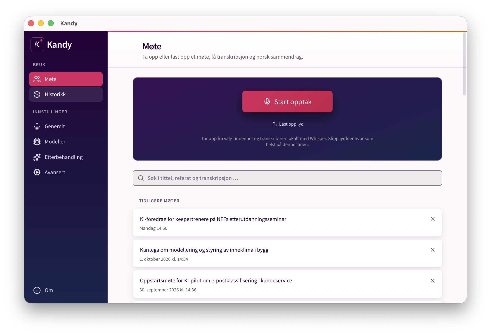

# Kandy



Kandy gjør tale om til tekst på Macen din. Hold en hurtigtast, snakk, og
teksten limes inn der markøren står. Kandy kan også ta opp møter og lage
referat.

Lyden transkriberes lokalt. Bare tekst til referat og etterbehandling går til
Kantega LLM-proxy, og bare hvis du har lagt inn nøkkel. Kandy er en fork av
[Handy](https://github.com/cjpais/Handy) og et forsøk, ikke et
Kantega-verktøy. Bruk på eget ansvar.

## Installer

1. Last ned DMG-en fra
   [GitHub](https://github.com/kantega/kandy/releases/latest). Velg
   `aarch64` for M1 eller nyere, `x64` for Intel.
2. Åpne DMG-en og dra Kandy til **Programmer**.
3. Første gang stopper macOS appen. Den enkleste løsningen er å lime inn dette
   i Terminal:

   ```bash
   /usr/bin/xattr -dr com.apple.quarantine /Applications/Kandy.app
   ```

   Du kan også gå til **Systeminnstillinger → Personvern og sikkerhet** og
   trykke **Åpne likevel**.

## Kom i gang

1. Gi tilgang til mikrofon og tilgjengelighet når du blir spurt.
2. Velg **Whisper Large v3** under **Modeller**. Den er best på norsk.
3. Sett en hurtigtast under **Generelt**.
4. Hold hurtigtasten, snakk og slipp.

For møtereferat legger du inn nøkkelen til Kantega LLM-proxy under
**Modeller**. Gå så til **Møte** og trykk **Start opptak**.

## Kjente begrensninger

- Kandy tar bare opp det mikrofonen hører. Med hodetelefoner i Teams eller
  Zoom kommer bare din egen stemme med.
- `fn`-tasten fungerer bare på Apple-tastaturer.
- Kun macOS.
- **Ny versjon:** last ned DMG-en på nytt og erstatt appen i **Programmer**.
  Kjør `xattr`-kommandoen over igjen. macOS ser hver versjon som en ny app, så
  tilgangen til tilgjengelighet slutter å virke selv om bryteren står på. Kjør
  dette og gi tilgang på nytt:

  ```bash
  tccutil reset Accessibility no.kantega.kandy
  ```

Alt lagres i `~/Library/Application Support/no.kantega.kandy/`. Slett mappen
for å nullstille appen.

## For utviklere

[BUILD.md](BUILD.md), [CONTRIBUTING.md](CONTRIBUTING.md) og
[AGENTS.md](AGENTS.md).

MIT-lisens. Bygger på [Handy](https://github.com/cjpais/Handy) av CJ Pais,
[Whisper](https://github.com/openai/whisper) og [Tauri](https://tauri.app).
